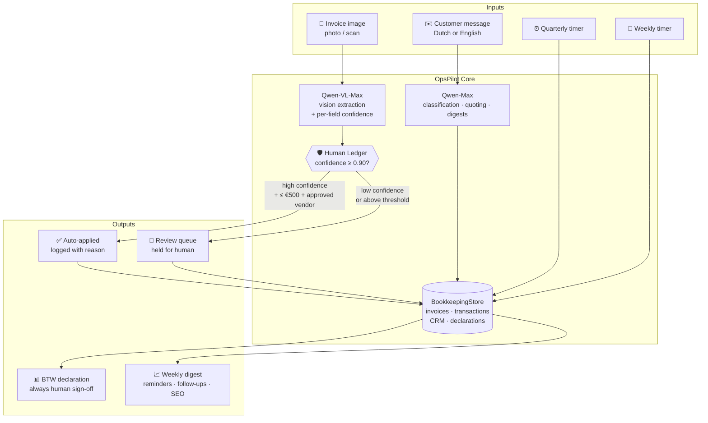

# OpsPilot 🇳🇱

**Full business-operations autopilot for Dutch SMEs — powered by Qwen Cloud.**

[](LICENSE)
[](tsconfig.json)
[](https://www.alibabacloud.com/en/solutions/generative-ai/qwen)
[](#)

OpsPilot automates the four operational workflows every small Dutch business runs on repeat — invoice processing, customer inquiries, quarterly BTW (VAT) declarations, and weekly growth review — **end-to-end**, while a named, inspectable governance layer (the **Human Ledger**) guarantees that every decision that matters is held for a human.

---

## Table of Contents

- [Why OpsPilot](#why-opspilot)
- [Architecture](#architecture)
- [The Human Ledger](#the-human-ledger)
- [The Four Workflows](#the-four-workflows)
- [Quick Start](#quick-start)
- [Configuration](#configuration)
- [Benchmark: Measured, Not Claimed](#benchmark-measured-not-claimed)
- [Tool Coverage (Auto-Counted)](#tool-coverage-auto-counted)
- [Qwen-Specific Capabilities](#qwen-specific-capabilities)
- [Project Structure](#project-structure)
- [Privacy & Data Handling](#privacy--data-handling)
- [Roadmap](#roadmap)
- [License](#license)

---

## Why OpsPilot

Running a small Dutch business means handling, every single week:

| Task | Pain | Risk of getting it wrong |
|---|---|---|
| Vendor invoices | Manual data entry from PDFs and photos | Wrong BTW deductions |
| Customer inquiries | Dutch + English, quotes, follow-ups | Lost revenue |
| BTW declaration | Quarterly, Belastingdienst format, 7-year archive duty | Tax penalties |
| Growth review | Overdue invoices, stale quotes, SEO | Slow decline nobody notices |

Each task is repetitive, important, and easy to get wrong. OpsPilot automates all four — but **never silently**. Every automated action is logged, confidence-scored, and gated.

## Architecture



Every Qwen call — model, kind, token counts, JSON validity — is appended to a persistent usage log, so the [tool-coverage report](#tool-coverage-auto-counted) is generated from real counts, never typed by hand.

## The Human Ledger

The governance layer, named and inspectable. Every action OpsPilot takes on business data is appended to `opspilot_ledger.jsonl`:

```json
{
  "timestamp": "2026-07-20T10:14:03.512Z",
  "action": "invoice_extraction",
  "confidence": 0.72,
  "status": "held_for_review",
  "reason": "low confidence on btwNumber (0.72)",
  "dataSummary": { "vendor": "…", "invoiceNumber": "…", "totalInclBtw": 847.0 }
}
```

**The rules are hard-coded, not prompt-suggested:**

1. Qwen-VL reports a confidence score **per extracted field**. The invoice's overall confidence is the **minimum** across fields — one glare-obscured BTW number is enough to hold the whole invoice.
2. Anything below **0.90** is held for review. It is never auto-filed into BTW calculations.
3. Auto-approval additionally requires amount **≤ €500** *and* the vendor on the approved list.
4. **BTW declarations are always held** for human sign-off before filing. No exceptions.

Inspect the queue any time via `ledger.reviewQueue()`, or aggregate stats via `ledger.stats()`.

## The Four Workflows

### 1 · Invoice Autopilot
`Qwen-VL-Max` reads the invoice image (photo or scan, Dutch or English) and extracts vendor, BTW number, invoice number, dates, line items, and totals — each with its own confidence score. Dutch `DD-MM-YYYY` dates are normalised to ISO. `Qwen-Max` then classifies the expense category. The Human Ledger decides: auto-apply, or hold.

### 2 · Customer Inquiry Autopilot
Classifies incoming messages (`sales_inquiry` / `support` / `complaint` / `spam`), detects language, extracts requirements, drafts a personalised quote against your service catalogue and pricing rules, and logs everything to the CRM with a scheduled follow-up date. Non-standard quotes are flagged `CUSTOM` for human review.

### 3 · BTW Declaration Autopilot
Aggregates the quarter's revenue and deductible expenses from the bookkeeping store, computes BTW owed (21% on revenue minus BTW paid on expenses), and produces a declaration — **always** `pending_human_review`, always ledgered.

### 4 · Growth Intelligence
Weekly: revenue trend vs the previous period, payment reminders for stuck invoices, follow-up drafts for quotes silent ≥ 7 days, an SEO blog outline for your top opportunity keyword, and a two-paragraph founder digest — with an escalation flag when monthly revenue tracks below 80% of target.

## Quick Start

**Prerequisites:** Node.js 18+, a [Qwen Cloud API key](https://www.alibabacloud.com/en/product/modelstudio).

```bash
git clone https://github.com/manojmallick/opspilot.git
cd opspilot
npm install

cp .env.example .env        # then add your QWEN_API_KEY

npm run dev                 # demo: BTW declaration + growth intelligence on sample data
```

## Configuration

| Variable | Default | Purpose |
|---|---|---|
| `QWEN_API_KEY` | — (required) | Qwen Cloud API key |
| `QWEN_BASE_URL` | `https://dashscope.aliyuncs.com/compatible-mode/v1` | OpenAI-compatible endpoint (use `dashscope-intl` outside mainland China) |
| `OPSPILOT_USAGE_LOG` | `opspilot_usage.jsonl` | Where Qwen call usage is appended |

Key operational constants (in code, deliberately explicit):

| Constant | Value | Where |
|---|---|---|
| Confidence auto-apply threshold | `0.90` | `src/humanLedger.ts` |
| Auto-approve amount ceiling | `€500` | `src/index.ts` |
| BTW rate | `21%` | `src/index.ts` |

## Benchmark: Measured, Not Claimed

OpsPilot ships a benchmark harness so extraction accuracy is a **measured number from real invoices**, not a marketing claim.

```bash
# 1. Put real invoice images (jpg/png/webp) in data/invoices/
# 2. Fill data/ground_truth.json with manually verified field values
#    (template documented at the top of src/benchmark.ts)
npm run benchmark
```

Output: field-level accuracy, per-invoice mismatches (expected vs got), how many invoices the Human Ledger held for review — printed and written to `benchmark_results.json`.

> **Honesty policy:** results are reported as-is, including misses. "23/24 fields correct across 4 real invoices, one BTW number misread on a low-resolution photo" beats an unmeasured "reads invoices accurately". Real issues found during benchmark runs are recorded in [CHALLENGES.md](CHALLENGES.md).

## Tool Coverage (Auto-Counted)

```bash
npm run coverage            # generates TOOL_COVERAGE.md
```

Every number comes from the persisted usage log and the Human Ledger: Qwen-VL call count, per-model call counts, structured-output JSON validity rate, token totals, and auto-applied vs held-for-review decisions. Zero hand-typed statistics.

## Qwen-Specific Capabilities

| Capability | Where it's used | Why it matters |
|---|---|---|
| **qwen-vl-max** vision | Invoice field extraction | Reads Dutch invoices from *photos*, not just clean PDFs |
| **qwen-max** reasoning | Classification, quotes, digests | Professional-quality Dutch + English output |
| Structured output | Every JSON response | Fence-stripped, validated, validity-rate tracked |
| Multilingual (NL/EN) | All workflows | Belastingdienst terminology handled natively, not translated |

## Scripts

| Command | What it does |
|---|---|
| `npm run dev` | Run `src/index.ts` with ts-node |
| `npm run build` | Compile TypeScript to `dist/` |
| `npm start` | Run the compiled build (`node dist/index.js`) |
| `npm run benchmark` | Run the measured benchmark (`src/benchmark.ts`) |
| `npm run coverage` | Count tool coverage (`src/coverage.ts`) |

## Project Structure

```
opspilot/
├── src/
│   ├── index.ts          # OpsPilot class — all four workflows + demo
│   ├── qwenClient.ts     # Qwen Cloud client: vision, JSON validation, usage tracking
│   ├── humanLedger.ts    # Human Ledger — confidence-gated human-in-the-loop
│   ├── benchmark.ts      # real-invoice accuracy benchmark
│   └── coverage.ts       # auto-counted Qwen tool-coverage report
├── data/
│   ├── invoices/         # your real invoice images (git-ignored)
│   └── ground_truth.json # manually verified fields  (git-ignored)
├── CHALLENGES.md         # real issues diary — filled during live runs
└── README.md
```

## Privacy & Data Handling

- Real invoice images, ground truth, the bookkeeping store, ledger, and usage logs are **all git-ignored** — no business data ever leaves the machine except to the Qwen API for processing.
- `.env` (API keys) is git-ignored; only `.env.example` is committed.
- Dutch invoices contain BTW numbers and business addresses — treat `data/` as confidential.

## Roadmap

- [ ] Email inbox trigger (invoice attachments → workflow 1 automatically)
- [ ] Belastingdienst submission-file export for the BTW declaration
- [ ] Google Search Console integration for live SEO data in workflow 4
- [ ] Web review-queue UI on top of the Human Ledger

## License

[MIT](LICENSE) © 2026 Manoj Mallick · Built for the Qwen Cloud Hackathon, Track 4 (Autopilot Agent).
